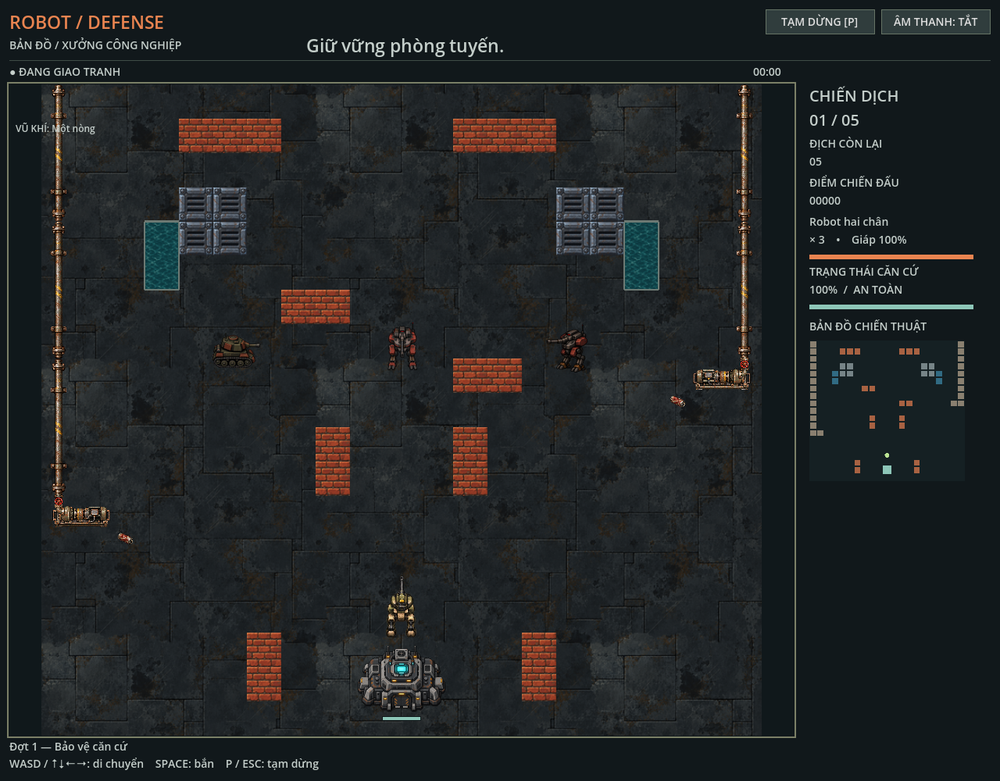

# Robot Defense

Game 2D top-down dùng Godot 4.7.2, GDScript và renderer Compatibility. Chọn map → nhân vật → Body/vũ khí rồi bảo vệ căn cứ qua 5 đợt. Có map nhà máy và thành phố bỏ hoang; desktop hiển thị toàn map, mobile ngang cuộn theo player.

```sh
make import
make dev
make test
```

WASD/mũi tên để di chuyển, Space để bắn, P/Escape để tạm dừng. Màn hình hẹp có D-pad và nút bắn. Hướng dẫn chạy, kiểm thử và trạng thái Web PWA ở [phát triển](docs/development.md); toàn bộ tài liệu ở [mục lục](docs/README.md).

- [Chọn nhân vật](docs/features/character-selection.md): Robot/Xe tăng, bảy loadout, stats và lịch bắn.
- [Power-up và pickup](docs/features/power-ups.md): hiệu ứng, sinh/rơi, lifetime và đổi weapon.
- [Web PWA](docs/features/web-pwa.md): build, offline cache, font, cập nhật và hosting.
- [Biên soạn map](docs/features/map/authoring.md): scene, TileSet, object, marker, validation và renderer.
- [Nhà máy](docs/features/map/industrial-layout.md) và [thành phố bỏ hoang](docs/features/map/abandoned-city.md): bố cục và luật vật cản.
- [Asset và nguồn](docs/README.md#asset): bộ runtime, reference, geometry và quy trình thay hình.
- [QA](docs/README.md#qa): phạm vi kiểm tra và giới hạn native/thiết bị/Web.

Runtime ở `assets/sprites/`, `assets/terrain/`, `assets/maps/` và `assets/map_objects/`. Nguồn hiện hành ở `assets/generated/`, được loại khỏi import/export. Quy ước source/tài liệu ở [AGENTS.md](AGENTS.md) và [bảo trì](docs/maintenance.md).


