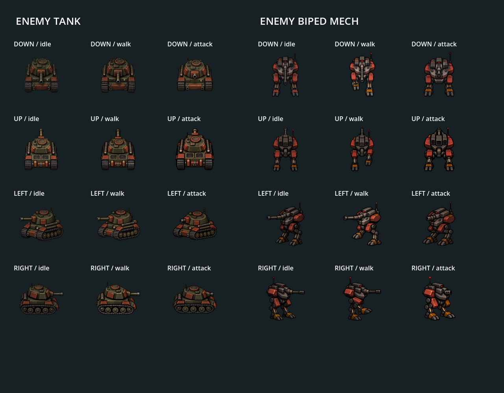
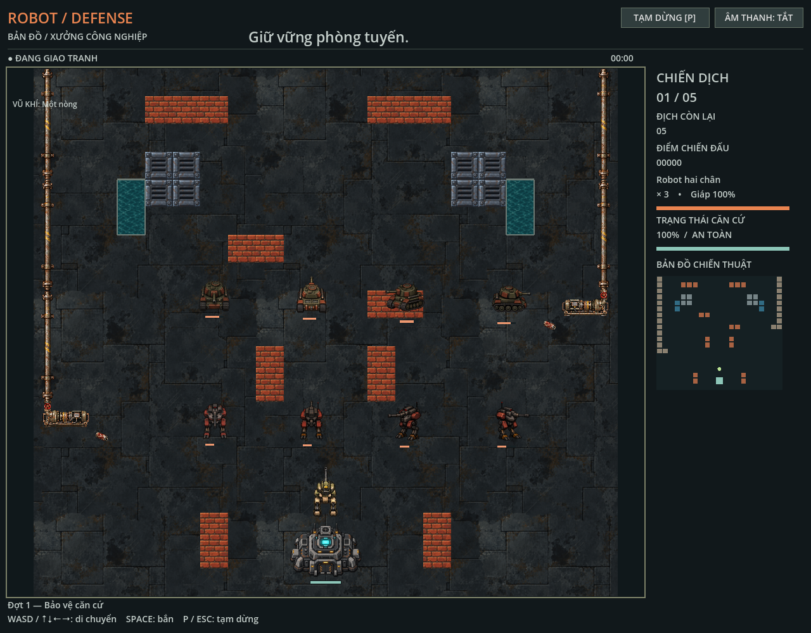

# Artwork enemy tank và mech

`BattleView.enemy_skins` bind gameplay kind `tank` tới `assets/sprites/enemy_tank/enemy_skin.tres` và `robot` tới `assets/sprites/enemy_mech/enemy_skin.tres`. HP, tốc độ, collider, wave và pathfinding thuộc simulation; thay skin không tự đổi gameplay.

Mỗi bộ có bốn hướng được vẽ độc lập. Mỗi hướng có idle 4 frame/4 FPS/loop, walk 6/10 FPS/loop và attack 4/12 FPS/one-shot, cell 128×128: 56 frame mỗi bộ. `enemy_skin.tres` map tới `<direction>.tres`, resource này liên kết `<direction>_frames.tres` và PNG; `<direction>_manifest.json` lưu rect, animation, geometry và source run.

Nguồn ở `assets/generated/sprites/enemy_tank/<direction>/` và `assets/generated/sprites/enemy_mech/<direction>/`. Giữ raw đã chọn, prompts, layout guides, direction anchor, frames, manifests, contact/GIF và inspect reports. Ảnh edit target vẫn nằm trong references; candidate rejected không còn dependency đã được dọn; provenance và correction prompts còn giữ lịch sử generation.

## Geometry từng hướng

Tank DOWN/UP có opaque area lớn hơn hai góc bên. Scale đã hiệu chỉnh: DOWN `0,408`, UP `0,472`, LEFT/RIGHT `0,5`. World-space opaque areas của frame idle đầu chênh khoảng 2,4%; kiểm tra asset giới hạn max/min dưới 1,10. Muzzle distances tương ứng là `16,32`, `20,768`, `34`, `35` units. Anchor vẫn tính theo pixel nguồn; runtime/generation manifests ghi geometry tương ứng. Collider và HP không đổi theo artwork scale.

Mech cũng có anchor/scale/muzzle riêng từng hướng. Khi thay một texture, giữ geometry hiện tại trừ khi đã đo lại ảnh; [workflow sprite](../workflows/sprites.md) mô tả installer. Không chạy installer với geometry mặc định để ghi đè giá trị đã hiệu chỉnh.

## Kiểm tra

`scenes/enemy_sprite_preview.tscn` hiển thị 24 animation của hai bộ. `godot_tests/enemy_sprite_asset.gd` kiểm tra từng direction/frame, thay hướng độc lập, tỷ lệ kích thước tank, clock và va chạm nòng sát tường/player. Script chạy trong `make test`; `godot_tests/enemy_sprite_visual.gd` trong `make test-visual` chụp board và tám hướng trong game.

[QA enemy sprites](../qa/enemy-sprites.md) ghi evidence extraction/motion và các giới hạn còn lại. Attack direction/khóa di chuyển được mô tả trong [Combat](../features/combat.md).

