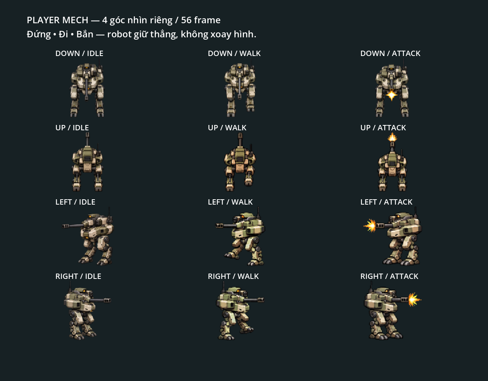

# Atlas player-mech: fixture và reference

Gameplay mặc định dùng [artwork nhân vật tách lớp](characters.md). Atlas player-mech còn được `BattleView` preload làm fallback, các resource `assets/loadouts/{standard,twin}.tres`, preview và regression load trực tiếp; đồng thời là reference cho generation nhân vật. Các file này vẫn là dependency đang dùng.

Bộ có bốn góc vẽ riêng, không xoay/mirror trong bộ fixture: DOWN nhìn trước, UP nhìn sau với giáp/vent/gót chân, LEFT/RIGHT là góc bên. Mỗi hướng có idle 4 frame/4 FPS/loop, walk 6/10 FPS/loop và attack 4/12 FPS/one-shot: 56 frame, cell 128×128.

| Resource trong `assets/sprites/player_mech/` | Nội dung |
| --- | --- |
| `player_mech.png`, `player_mech.tres`, `manifest.json` | DOWN, atlas 768×384, 14 frame |
| `player_mech_directions.png`, `player_mech_directions.tres`, `directions_manifest.json` | UP/RIGHT/LEFT, atlas 768×1152, 42 frame |
| `player_skin.tres` | Frame, anchor, scale, socket và vùng tách Body/nòng của fixture |

Scale là 0,5. Anchor theo pixel ảnh: DOWN `(64,50)`, UP `(64,54)`, RIGHT `(45,45)`, LEFT `(83,45)`. Muzzle distances theo world units là 15/23/31/33 tương ứng. Loadout tính geometry cho simulation khi khởi tạo, renderer bind Body từ loadout. Không chỉ đổi `BattleView.player_skin` để thay artwork gameplay vì binding này được simulation ghi lại.

Các fixture ghép Body/nòng bằng vùng atlas và giáp socket; hợp đồng ở [Body/Weapon/Loadout](../features/player-loadout.md). Animation attack trong gameplay kéo dài 0,23 giây, độc lập tốc độ preview 12 FPS và cooldown. Đi/bắn, pause, damage và hồi sinh dùng các clock simulation chung.

## Nguồn và thay thế

Nguồn hiện hành: `assets/generated/sprites/player_mech/down/` và `assets/generated/sprites/player_mech/directions/`. Giữ raw được chọn, request, prompt, direction anchors, manifests và QA reports vì chúng tái tạo atlas/reference đang dùng. Các candidate bị loại đã được dọn; provenance vẫn lưu lịch sử generation và correction.

Với layout giống hệt, có thể thay PNG; layout khác phải cập nhật AtlasTexture regions từ composed manifest. Khi đổi anchor/scale/súng, cập nhật socket, Body exclusions, weapon regions và muzzles cùng nhau. SpriteFrames có thể dùng PNG riêng cho một hướng, giữ các hướng còn lại. Quy trình chi tiết ở [Sprite workflow](../workflows/sprites.md).

## QA

[QA player-mech](../qa/player-mech.md) giữ evidence generation, giới hạn motion và phạm vi regression. Preview dùng `scenes/player_mech_preview.tscn`; `godot_tests/player_mech_asset.gd` và loadout tests chạy trong `make test`.

`godot_tests/player_mech_visual.gd` chụp chiến trường với player hiện hành tại `/private/tmp/robot-defense-player-<direction>.png`, rồi chụp board fixture bên dưới. Do đó ảnh battle từ script này không xác nhận riêng atlas fixture. `make test-visual` chạy script này cùng board loadout và nhân vật.

