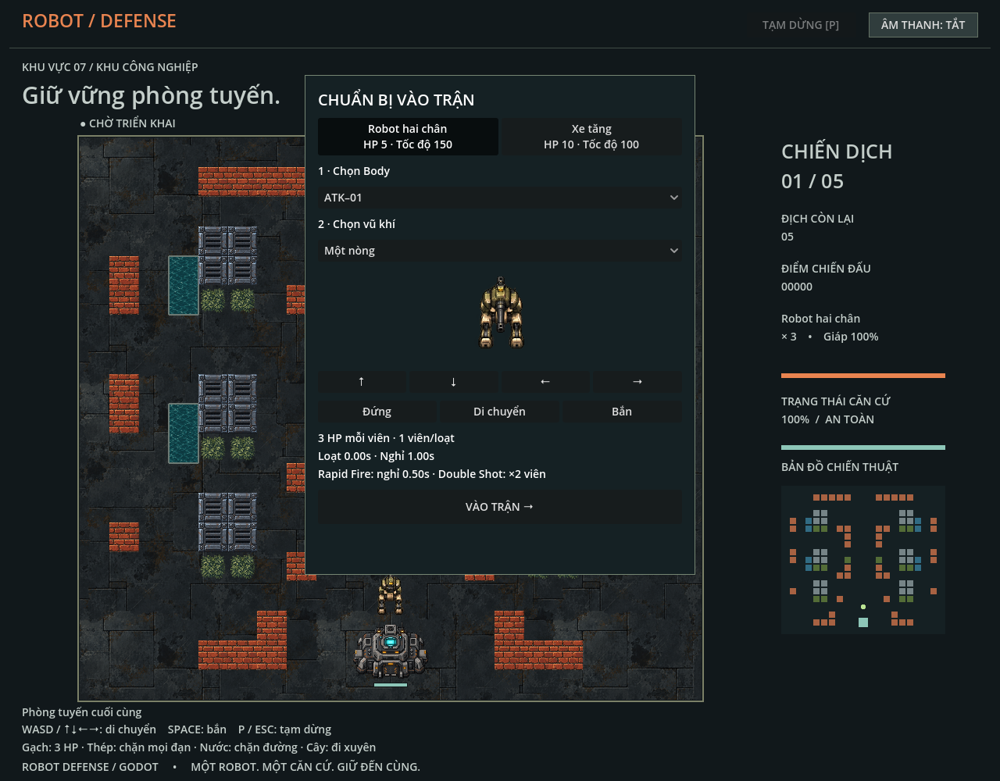
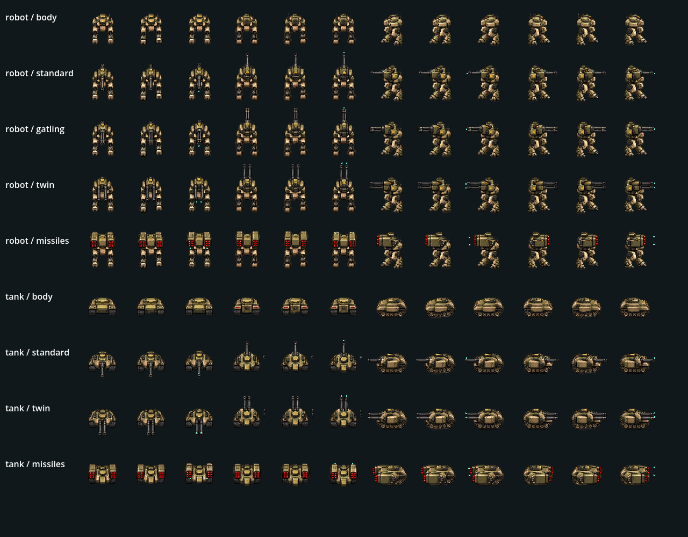

# Chọn nhân vật và vũ khí trước trận

Game mở bằng chọn map → chọn Robot/Xe tăng → Body → một vũ khí tương thích → vào trận. Lựa chọn không lưu ra đĩa; mỗi lần mở game lấy mặc định từ config. Sau thắng/thua giữ lựa chọn hiện tại để chơi lại hoặc đổi nhân vật/map. Robot, Xe tăng và mọi vũ khí đều mở sẵn.

`config/player_characters.json` là nguồn thông số chung cho UI và `Simulation.new()` độc lập. `gd/character_catalog.gd` kiểm tra ID, tham chiếu, tương thích, stats, geometry và schedule rồi dựng [Body/Weapon/Loadout](player-loadout.md). Config sai báo mục lỗi; chỉnh config cần khởi động lại, bản đóng gói cần export lại. Export Web bao gồm JSON và manifest artwork; chưa hỗ trợ reload trong trận.

## Nhân vật

Mỗi nhân vật hiện có một Body, dữ liệu hỗ trợ danh sách Body. Giáp trên UI chính là HP, không có lớp giảm sát thương riêng. Collider radius là 14 world units và độc lập alpha artwork.

| Nhân vật | Body | HP | Tốc độ (units/giây) | Vũ khí tương thích |
| --- | --- | --- | --- | --- |
| Robot hai chân | ATK–01 (`robot_body`) | 5 | 150 | Một nòng, Gatling, hai nòng, tên lửa hai bên |
| Xe tăng | Vanguard (`tank_body`) | 10 | 100 | Một nòng, hai nòng, tên lửa hai bên |

Chỉ trang bị một vũ khí tại một thời điểm. Cặp tên lửa trái/phải là một lựa chọn. Weapon pickup tương thích có thể thay vũ khí trong trận, hủy loạt chưa bắn của vũ khí cũ và cập nhật artwork/geometry; xem [Pickup và power-up](power-ups.md).

## Nhịp bắn và sát thương

Thời gian nghỉ tính từ event cuối của loạt đến event đầu của loạt kế tiếp. Thời điểm trong bảng tính từ lúc kích hoạt loạt.

| Vũ khí | Damage mỗi viên/quả | Event cơ bản | Nghỉ sau loạt |
| --- | --- | --- | --- |
| Một nòng | 3 HP | 1 viên tại 0 giây | 1 giây |
| Gatling (Robot) | 1 HP | 6 viên tại 0; 0,1; 0,2; 0,3; 0,4; 0,5 giây | 0,8 giây |
| Hai nòng | 1 HP | 2 viên song song tại 0 giây | 0,6 giây |
| Tên lửa | 3 HP | Phải tại 0 giây, trái tại 0,3 giây | 1,5 giây |

Súng bay 410 units/giây, tên lửa 300. Mỗi projectile bay thẳng, chạm đối tượng đầu tiên rồi biến mất; không homing, xuyên mục tiêu hoặc AoE. Hai viên của hai nòng va chạm độc lập, cùng trúng thì tổng damage 2 HP. Enemy/Brick/vật thể phá được nhận damage từng viên; steel chặn mà không mất HP. Vật thể map có rule riêng có thể cho đạn đi xuyên; xem [Combat](combat.md).

Loạt đã bắt đầu bắn hết dù thả nút. Khi còn event chờ, player giữ vị trí/hướng và không di chuyển. Mở khóa ngay sau event cuối; có thể đi trong thời gian nghỉ. Loạt một nòng/hai nòng cơ bản hoàn tất tức thời. Gatling khóa 0,5 giây, tên lửa khóa 0,3 giây. Giữ nút bắn tự bắt đầu loạt mới khi hết nghỉ. Animation/recoil không kéo dài khóa.

## Rapid Fire và Double Shot

Rapid Fire nhân thời gian nghỉ với 0,5, không đổi thời điểm trong loạt: một nòng 0,5 giây, Gatling 0,4, hai nòng 0,3, tên lửa 0,75.

Double Shot nhân đôi viên, giữ damage và thời gian nghỉ cơ bản. Khoảng lặp của một nòng/hai nòng/từng bên tên lửa lấy từ `power_ups.double_shot_delay`, hiện 0,08 giây.

| Vũ khí | Schedule Double Shot | Khóa đến |
| --- | --- | --- |
| Một nòng | 1 viên tại 0 và 0,08 giây | 0,08 giây |
| Hai nòng | 1 cặp tại 0 và 0,08 giây; tổng 4 viên | 0,08 giây |
| Gatling | 12 viên phân bố đều trong 0,5 giây, khoảng `0,5 / 11` | 0,5 giây |
| Tên lửa | Phải tại 0 và 0,08; trái tại 0,38 và 0,46 giây | 0,46 giây |

Kết hợp hai power-up áp dụng schedule Double Shot và nghỉ ×0,5. Schedule/cooldown được chốt khi bắt đầu loạt: pickup hoặc expiry giữa loạt không đổi các event đã chốt, áp dụng từ lần kích hoạt tiếp theo. Pause dừng hàng đợi và mọi clock. Chết hủy event còn chờ của actor cũ; loadout và thời gian power-up còn lại giữ qua hồi sinh. Weapon pickup thay vũ khí là trường hợp hủy loạt ngay.

## Màn hình chuẩn bị và artwork

UI có hai thẻ nhân vật, HP/tốc độ, Body, các vũ khí tương thích, mô tả damage/số viên/thời lượng/nghỉ và nút vào trận. Preview có bốn hướng và đứng/đi/bắn, dùng cùng dữ liệu/renderer với chiến trường. Pose bắn minh họa recoil, lịch thực tế được simulation kiểm tra. ScrollContainer giúp màn hình nhỏ cuộn tới nút vào trận. Có thể quay về chọn map; chọn lại sau thắng/thua tạo simulation mới khi vào trận.

Atlas `assets/sprites/characters/layers.png` có 36 pose: hai Body sạch và bảy bộ vũ khí × bốn hướng. Body hoàn chỉnh không chứa nòng/bệ tên lửa/flash; runtime không cắt súng cũ hoặc vẽ giáp bù. Manifest khai báo region, anchor, scale, roof socket, stride/recoil và vùng tên lửa sau thân. Các góc được vẽ riêng.

Idle dùng pose tĩnh. Walk chuyển động nhỏ phần chân/xích dưới torso/socket cố định. Recoil vũ khí đọc shot clock; flash/phóng đọc event projectile đúng nòng/bên. Góc ngang tên lửa ghép lớp phía sau trước Body rồi lớp phía trước. Chi tiết [rendering](robot-sprites/rendering.md) và [nguồn artwork](../assets/characters.md) mô tả cách thay asset và hạn chế animation.

Config lưu geometry từng nòng theo world units từ tâm actor; catalog đổi sang offset socket. Simulation quét đoạn từ trục collider đến nòng với bước tối đa 2 units, rồi quét đường đạn với bước tối đa 5 units để tránh sinh đạn qua vật cản/địch sát thân. Override chiều dài nòng giữ offset ngang riêng. Actor cooldown bằng thời lượng schedule cộng nghỉ đã chốt; mỗi update xử lý mọi event đến hạn trước, chỉ di chuyển phần thời gian còn lại sau event cuối. Bước simulation giới hạn 0,05 giây nên thời điểm event quan sát được có sai số tối đa một bước.

## Kiểm tra và giới hạn

`make test` chạy `godot_tests/character_selection.gd` cho cả bảy loadout/bốn hướng, config validation, stats, damage, muzzles, nhịp bắn, release/hold, khóa/mở khóa, pause, chết/hồi sinh và mọi tổ hợp Rapid Fire/Double Shot. Bao phủ pickup/expiry giữa loạt và delay lấy từ config. Regression fixture atlas/loadout vẫn chạy độc lập; không phải stats mặc định.

`make test-visual` chạy `godot_tests/character_selection_visual.gd` chụp desktop 1280×1000, mobile 390×844, màn hình nhỏ 320×568, trận tank/missile, Body riêng và bảy loadout ở bốn hướng × ba trạng thái × bốn frame chuyển tiếp. Chấm xanh trong board attack là marker geometry, không phải flash gameplay. Test/render native không xác nhận Web PWA hoặc điện thoại thật. Procedural walk có thể thay bằng các pose locomotion riêng trong tương lai.

