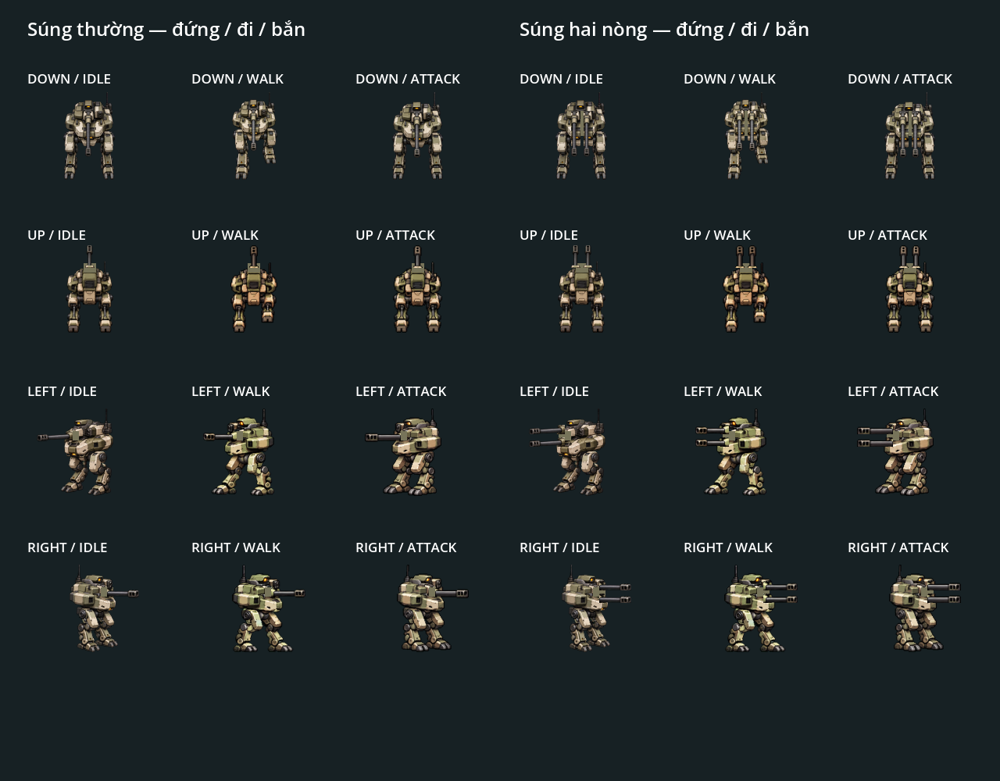
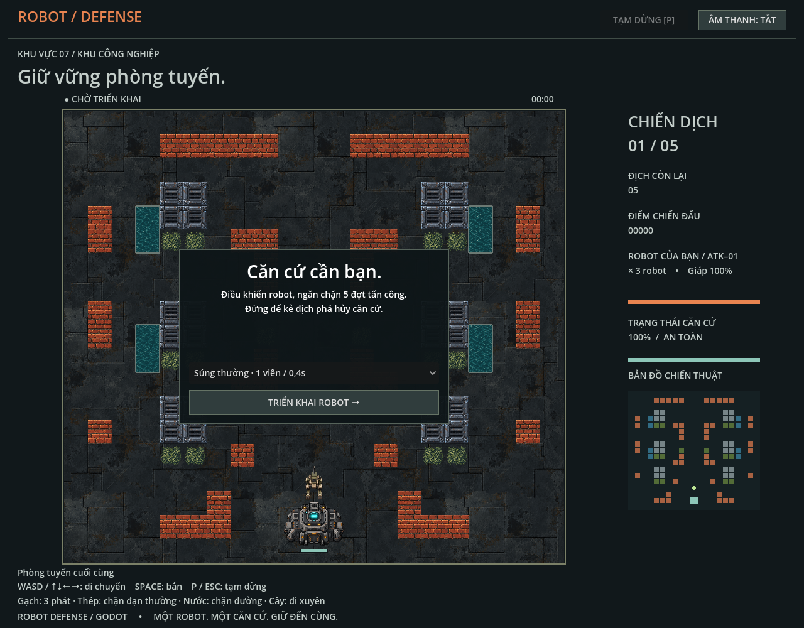

# Resource loadout và bộ atlas tham chiếu

Gameplay hiện hành dùng [Chọn nhân vật](character-selection.md) với thân sạch, 7 loadout và config chung. Phần bên dưới ghi lại bộ hai loadout cũ còn dùng làm reference và fixture regression; các thông số cũ không phải mặc định của game.

Bộ cũ gồm một thân ATK–01, socket nóc và hai súng. Chọn súng trong màn hình chờ trước khi triển khai; sau thắng/thua có thể đổi súng cho trận tiếp theo. Pause không cho đổi cấu hình. Hồi sinh và chơi lại giữ lựa chọn hiện tại; chơi lại tạo simulation mới và xóa trạng thái trận cũ.

## Hành vi bắn

| Súng | Viên mỗi loạt | Cooldown | Sát thương mỗi viên | Tốc độ đạn |
| --- | --- | --- | --- | --- |
| Súng thường | 1 | 0,4 giây | 1 | 410 world units/giây |
| Súng hai nòng | 2 đồng thời | 0,6 giây | 1 | 410 world units/giây |

Hai nòng lệch ±4 world units theo trục vuông góc hướng bắn. Mỗi viên có ID, vị trí nòng, flash và va chạm riêng. Một nòng bị chặn không làm nòng còn lại ngừng bắn. Các viên xử lý tuần tự: nếu viên đầu phá tường hoặc hạ địch, viên sau kiểm tra trạng thái đã cập nhật; score chỉ tính một lần cho mỗi địch bị hạ.

Rapid Fire chia đôi cooldown của súng đang lắp. Double Shot lặp lại cả loạt sau 0,08 giây, giữ vị trí và hướng lúc kích hoạt. Pause đóng băng cả hàng đợi. Khi robot bị phá hủy, loạt đang chờ của robot cũ bị hủy; hiệu lực power-up còn lại và loadout vẫn được giữ khi hồi sinh. Animation attack dùng 0,23 giây riêng, không kéo dài theo cooldown của súng hai nòng.

## Resource và trách nhiệm

- `gd/player_skin.gd` và `assets/sprites/player_mech/player_skin.tres`: frame/animation thân, anchor, scale, socket và vùng loại súng cũ khỏi thân.
- `gd/player_weapon.gd` và `assets/weapons/{standard,twin}.tres`: frame/anchor/scale súng, vùng lấy hình, offset đầu nòng, số nòng, cooldown, damage, tốc độ đạn và thời lượng attack.
- `gd/player_loadout.gd` và `assets/loadouts/{standard,twin}.tres`: liên kết thân, súng và socket `roof`; hợp nhất geometry trước khi tạo trận.
- `gd/main.gd`: chọn loadout qua OptionButton, truyền vào constructor `Simulation.new(configuration)` trước triển khai hoặc chơi lại.
- `gd/simulation.gd`: sở hữu cooldown, sinh từng viên, kiểm tra đoạn nòng, bước di chuyển, va chạm và sát thương. Simulation chạy độc lập có geometry đầy đủ từ loadout, không cần view thiết lập player.
- `gd/battle_view.gd`: vẽ thân rồi súng tại socket, dùng cùng frame index và tint cho cả hai lớp. View tiếp tục cấp geometry enemy theo skin enemy.

Socket của thân lưu trong pixel ảnh gốc, quy đổi thành world offset bằng `(socket - body_anchor) * body_scale`. Offset nòng trong weapon là world units tính từ socket. Tọa độ sinh viên là `actor.pos + socket_world + weapon_muzzle_offset + lateral * barrel_offset`. Anchor và scale súng độc lập với thân. Không xoay hoặc mirror cả robot khi ghép bốn hướng.

`player_muzzle_distances` còn là override độ dài theo hướng để hỗ trợ các bài QA/skin cũ; giá trị ban đầu được tính từ loadout. Offset ngang của từng nòng được giữ khi dùng override. Collider gameplay vẫn độc lập với alpha và vùng cắt artwork.

## Tách và ghép hình ảnh

Thân và súng dùng các vùng riêng của hai atlas hiện có; không tạo lại artwork hoặc xóa nguồn cũ. `weapon_cutouts` của thân loại vùng nòng gốc, còn `cutouts` của weapon lấy riêng vùng đó. Socket có tấm giáp đỡ để phần gắn súng không bị hở khi dùng hai nòng. Súng thường ghép một lớp; súng hai nòng ghép hai lớp lệch ngang. Mỗi lớp giữ đủ 56 frame ở bốn hướng và ba trạng thái idle/walk/attack.

Chớp nòng có vùng riêng ở frame attack thứ hai. `gd/sprite_regions.gd` chia các rectangle bằng phép trừ vùng; không dùng một bounding box lớn bao cả nòng và flash, tránh cắt hoặc nhân đôi phần giáp thân ở giữa. PNG gốc vẫn là nguồn chung của hai lớp; không phải atlas thân sạch có thể dùng trực tiếp bằng AnimatedSprite2D. Khi thay artwork, cập nhật vùng cắt của thân, vùng/anchor của súng và socket/muzzle tương ứng. Các súng khác về hình dáng có thể dùng PNG và SpriteFrames riêng nếu tuân thủ hợp đồng animation.

Đây là tách lớp theo vùng atlas, có tấm giáp bù tại socket; hình ảnh hai nòng tái sử dụng hình của nòng thường. Nguồn atlas và generation vẫn là dependency đang dùng, không phải run đã bị thay thế.

## QA

`make test` chạy `godot_tests/player_loadout.gd`: 392 kiểm tra, 0 lỗi. Bao phủ hai loadout, bốn hướng, đủ frame animation, bắn đứng/di chuyển, gạch/thép sát nòng, địch gần, chỉ một nòng bị chặn tại ranh giới tile, cooldown, Rapid Fire, Double Shot, pause/resume, hồi sinh và đổi/giữ lựa chọn khi chơi lại. Test resource tùy chỉnh xác nhận geometry, damage và tốc độ đạn được lấy từ cấu hình súng.

Toàn bộ bộ test hiện có cũng đạt: power-up 39, acceptance 234, enemy sprite 264, map art 24 và player sprite/integration. Render native bằng `godot --path . --script godot_tests/player_loadout_visual.gd` đã chụp màn hình desktop 1280×1000, mobile 390×844, trận dùng hai nòng và 24 ô hướng/animation, gồm frame chớp nòng. Ảnh tài liệu ở trên; ảnh mobile, battle và frame bổ sung nằm trong `/private/tmp/player-loadout-*.png`. Lệnh này có trong `make test-visual`.

## Mở rộng sau

Ổ lắp hai bên, súng tên lửa, tự ngắm và nhiều thân nằm ngoài phạm vi đầu tiên. Trước khi thêm nhiều socket cần xác định thứ tự bắn/cooldown giữa các ổ; trước khi thêm tên lửa cần xác định đạn chậm hay nổ diện rộng. Weapon hiện dùng projectile thẳng; loại đạn khác cần bổ sung hành vi trong simulation cùng QA riêng.
