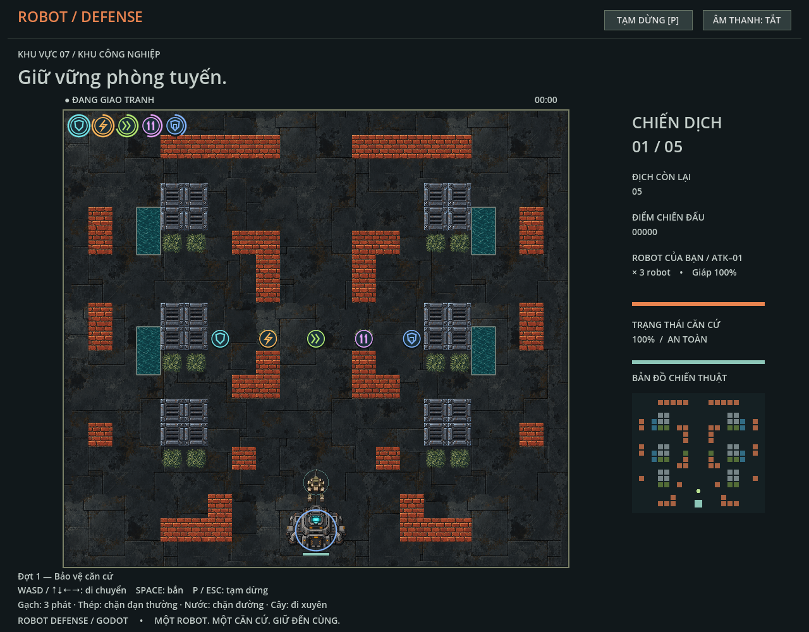

# Power-ups

## Mục tiêu

Power-up tạo các đợt tăng sức mạnh tạm thời cho player và căn cứ. Đây là spec gameplay; thời lượng, nhịp sinh và số lượng tối đa là mặc định có thể cân chỉnh tập trung.

## Danh sách vật phẩm

| ID | Tác dụng | Thời lượng mặc định |
| --- | --- | ---: |
| `shield` | Giảm mọi sát thương lên player về 0 trong thời gian hiệu lực. | 5 giây |
| `rapid_fire` | Giảm một nửa thời gian nghỉ giữa các loạt; giữ thời lượng loạt. | 5 giây |
| `double_shot` | Nhân đôi số viên của loạt theo schedule từng vũ khí. | 5 giây |
| `base_shield` | Giảm mọi sát thương lên căn cứ về 0 trong thời gian hiệu lực. | 5 giây |
| `speed_boost` | Tăng tốc độ di chuyển của player lên 1.5 lần. | 5 giây |

Các hiệu ứng khác loại được phép hoạt động đồng thời. Nhặt vật phẩm cùng loại khi hiệu ứng đang chạy làm mới thời gian về 5 giây; không cộng dồn hệ số hay thời gian. Shield và Base Shield bảo vệ liên tục trong cả thời hạn, không tiêu hao theo số hit. Hết thời gian, hiệu ứng tự kết thúc. Bộ đếm hiệu lực dừng khi game pause.

Rapid Fire giảm thời gian nghỉ sau viên cuối. Double Shot nhân đôi số viên và giữ sát thương/thời gian nghỉ; Gatling giữ thời lượng 0,5 giây, tên lửa bắn cặp phải rồi cặp trái. Cả hai kết hợp được. Chi tiết schedule nằm trong [Chọn nhân vật](character-selection.md). Mỗi viên va chạm độc lập.

## Xuất hiện và nhặt

Power-up xuất hiện theo hai nguồn:

1. **Sinh theo thời gian:** mặc định cứ 5 giây thử sinh từ 1 đến 2 vật phẩm, với tổng số vật phẩm trên bản đồ không vượt quá 10. Nếu còn ít chỗ trống hơn số lượng được chọn, chỉ sinh vừa đủ chỗ.
2. **Rơi từ tường:** khi brick hoặc steel bị phá hủy, có thể rơi một vật phẩm. Cả hai loại tường dùng cùng một xác suất rơi và cùng bảng chọn loại vật phẩm.

Vật phẩm ngẫu nhiên chỉ được đặt trên ô mà player có thể đi tới, không nằm trên ô đang bị chiếm bởi tường/căn cứ/actor/vật phẩm khác và phải cách player tối thiểu một khoảng an toàn để không xuất hiện ngay sát bên. Thuật toán chọn ô cần thử nhiều vị trí hợp lệ; nếu không tìm được thì bỏ lần sinh đó. Vật phẩm rơi từ tường đặt tại ô tường vừa bị phá nếu ô đó hợp lệ; nếu không thể đặt thì bỏ vật phẩm rơi.

Khi player chạm vật phẩm, vật phẩm biến mất và hiệu ứng được kích hoạt hoặc làm mới. Khi enemy chạm vật phẩm, vật phẩm biến mất mà không kích hoạt hiệu ứng. Vật phẩm trên bản đồ có thời hạn tồn tại hữu hạn, mặc định 10 giây, sau đó tự biến mất. Đồng hồ sinh vật phẩm và tuổi thọ vật phẩm dừng khi game pause.

## Tỉ lệ

Việc có sinh hay rơi vật phẩm được tách khỏi việc chọn loại vật phẩm. Mỗi lần đã quyết định sinh một vật phẩm, chọn loại theo trọng số cấu hình. Trọng số khởi điểm để cân chỉnh:

| Vật phẩm | Trọng số |
| --- | ---: |
| Shield | 30 |
| Rapid Fire | 25 |
| Speed Boost | 20 |
| Double Shot | 15 |
| Base Shield | 10 |

Đây là trọng số tương đối, không phải xác suất của từng nhịp sinh. Xác suất rơi tường là một cấu hình riêng dùng chung cho brick và steel; giá trị khởi điểm cần được chọn và kiểm tra trong quá trình triển khai. Khi rơi một vật phẩm, bảng trọng số ở trên được dùng như khi sinh theo thời gian.

## Giao diện

Mỗi hiệu ứng đang hoạt động hiển thị icon riêng và vòng tròn countdown quanh icon. Countdown biểu diễn thời gian còn lại trên tổng 5 giây; nhặt lại cùng loại làm vòng tiến độ đặt lại. Chỉ hiển thị icon của hiệu ứng đang hoạt động. Vật phẩm chưa nhặt trên bản đồ có hình dễ phân biệt với nền và tường.

## Quy tắc và giới hạn

- Vật phẩm không thể vượt quá giới hạn 10 vật phẩm trên bản đồ; vật phẩm rơi từ tường cũng tuân theo giới hạn này.
- Giới hạn tính vật phẩm đang nằm trên map, không tính hiệu ứng đã được nhặt.
- Sinh theo thời gian chọn ngẫu nhiên 1–2 vật phẩm mỗi nhịp; khả năng đặt hợp lệ và giới hạn map có thể làm số thực tế thấp hơn.
- Vật phẩm không thay đổi bản thân hoặc HP của enemy.
- Khi player bị phá hủy và respawn, hiệu ứng player còn hiệu lực tiếp tục với thời gian còn lại; Base Shield độc lập với trạng thái player.
- Tường thép cần có trạng thái HP/phá hủy để có thể rơi vật phẩm; đạn thường vẫn không phá được steel cho đến khi có quy tắc đạn/nâng cấp cho phép.

## Tham chiếu triển khai hiện tại

Mô phỏng gameplay nằm trong `gd/simulation.gd`; quy tắc và khả năng đi trên map nằm trong `gd/rules.gd` và `gd/battle_map.gd`; phần vẽ map nằm trong `gd/map_terrain.gd` và `gd/battle_view.gd`. Các cơ chế trong spec đã được triển khai. Icon dùng hình học vector dùng chung ở `gd/power_up_icons.gd`; HUD nằm ở `gd/power_up_hud.gd`, độc lập với scale map và co lại trên màn hình nhỏ. Hover icon HUD hiển thị tên và số giây còn lại.

## Tuning đã chọn

Sinh vật phẩm/thời lượng nằm trong `gd/rules.gd`; HP/tốc độ/nhịp bắn và biến đổi Rapid Fire/Double Shot nằm trong `config/player_characters.json`.

| Thông số | Giá trị hiện hành |
| --- | ---: |
| Nghỉ súng một nòng | 1 giây sau viên cuối |
| Nghỉ một nòng khi Rapid Fire | 0,5 giây sau viên cuối |
| Thời lượng animation bắn | 0,23 giây, độc lập cooldown |
| Khoảng cách tối thiểu khi sinh theo thời gian | 120 world units (3 ô) |
| Bán kính nhặt | 25 world units giữa tâm actor và vật phẩm |
| Xác suất rơi khi phá tường | 25%, chung cho brick và steel |
| HP thép | 5; đạn thường không trừ HP |
| Độ trễ viên thứ hai | 0,08 giây; khoảng cách xấp xỉ 33 world units ở tốc độ đạn 410 |

Đây là cấu hình khởi điểm đã được kiểm tra cơ chế; độ khó và cảm giác chơi cần tiếp tục cân chỉnh qua playtest.

## Quyết định triển khai và invariants

- Simulation giữ vật phẩm trên map tách biệt với dictionary thời gian hiệu ứng. Effect không gắn với dictionary actor nên respawn không mất effect; simulation mới xóa toàn bộ trạng thái.
- Flood fill bốn hướng từ ô player tìm vùng đi được thực sự, chặn brick/steel/water và căn cứ. Không dùng đường Dijkstra của enemy vì thuật toán đó cho phép tính đường qua gạch chưa phá. Actor tạm thời không ngăn flood fill nhưng chặn ô đặt vật phẩm.
- Mỗi nhịp chọn 1–2 vật phẩm rồi thử các ô ngẫu nhiên không lặp cho tới khi tìm được ô hợp lệ hoặc hết ứng viên. RNG riêng của simulation cho phép test bằng seed mà không ảnh hưởng random toàn cục.
- Vật phẩm rơi chỉ dùng tâm ô vừa phá; kiểm tra reachability, actor, vật phẩm, căn cứ và giới hạn map. Khoảng cách an toàn 120 chỉ áp dụng sinh theo thời gian; rơi tường không chuyển sang ô khác.
- Khi player và enemy cùng chạm trong một update, player được ưu tiên. Pickup xử lý sau di chuyển và trước bước đạn. Nhặt Rapid Fire thay cooldown của lần kích hoạt kế tiếp; không sửa cooldown đang đếm.
- Loạt bắn và thời gian nghỉ chốt tại lần kích hoạt, giữ vị trí/hướng đến viên cuối. Effect hết hạn không hủy viên đã chốt; hồi sinh hủy hàng đợi của actor cũ. Pause dừng hàng đợi. `emit_player_volley()` và `emit_projectile()` giữ kiểm tra đoạn nòng và va chạm từng viên.
- `damage_wall(point, can_damage_steel)` là điểm xử lý HP/phá hủy chung. Thép chỉ nhận damage khi caller cho phép; chưa có vật phẩm nào mở khóa phá thép. Phá tường cập nhật revision và xóa target enemy trước khi thử rơi vật phẩm.
- Icon vẽ sau foliage để dễ thấy vật phẩm trong cây. HUD chỉ vẽ effect còn hiệu lực; vòng countdown đọc thời gian simulation nên pause/refresh không có đồng hồ UI riêng.

## Gameplay QA

Chạy `make test` để kiểm tra power-up cùng các kiểm tra gameplay và asset hiện có. `godot_tests/power_ups.gd` kiểm tra pickup player/enemy, refresh và stacking khác loại, pause, expiry, shield nhiều hit, respawn, tốc độ, Rapid Fire + Double Shot, va chạm từng viên và nòng dài, sinh an toàn/reachability, giới hạn map, tuổi thọ, thép, xác suất rơi chung và trọng số với seed cố định.

Chạy `godot --path . --script godot_tests/power_up_visual.gd` để kiểm tra native desktop, pause, màn hình 320×568, tooltip và binding khi chơi lại. Screenshot desktop dùng 5 hiệu ứng với thời gian khác nhau và 5 vật phẩm mẫu; đây là fixture kiểm tra rendering, không phải vật phẩm đã sinh ngẫu nhiên.

Kết quả ngày 2026-10-11: `make test` pass; power-up 39 checks, acceptance 234 checks, player integration/56 atlas frames pass, enemy 264 checks, map 24 checks. Native power-up visual: 3 screenshots, 0 failures; đã xem ảnh desktop và mobile để kiểm tra icon riêng, vòng countdown và độ tương phản. `git diff --check` pass. Chưa cân chỉnh độ khó bằng playtest dài hoặc xác nhận rendering Web PWA.
