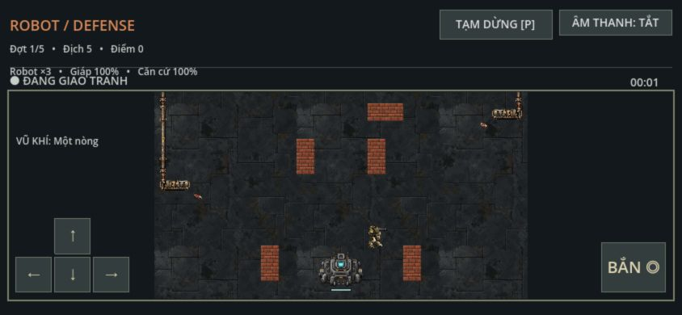

# QA Web PWA

## Kiểm tra ngày 15/10/2026

Môi trường: macOS, Godot `4.7.2.stable.official.ed1daf0bf`, Chrome desktop và trình duyệt nhúng Codex, localhost cổng 8080. Đây là browser smoke trên máy tính; không chứng nhận thiết bị cảm ứng thật.

| Phạm vi | Kết quả |
| --- | --- |
| Templates | Có debug và release single-thread; template release tải từ mirror chính thức và kiểm tra CRC/ZIP |
| Export | `make build` release thành công; HTML, JS, WASM, PCK, manifest, worker và icons được tạo |
| HTTP | WASM trả HTTP 200 và `application/wasm` |
| Gameplay browser | Chọn map → nhân vật → vào trận, di chuyển, bắn và pause phản hồi; cả debug và release cuối không có console warning/error trong smoke |
| Manifest | Chrome nhận diện nút cài PWA; còn cảnh báo tùy chọn về screenshots cho giao diện cài phong phú |
| Cài desktop | Chrome báo Successfully installed; Robot Defense mở trong cửa sổ ứng dụng riêng |
| Offline | Sau precache đầy đủ, bật Offline trong DevTools và reload; release khởi động lại tới màn chọn map |
| Màn hình nhỏ | Browser viewport 844×390: cuộn được màn chọn map/nhân vật, vào trận và thấy D-pad/nút bắn; release cuối hiển thị đúng mũi tên |
| Regression | `make test` chạy thành công toàn bộ suite; kiểm tra resource/link/fingerprint không có failure |

Bản release cuối được mở từ origin local sạch để tách cache debug cũ; ảnh trên chụp ở `http://127.0.0.1:8081/index.html`. Kiểm tra script sau export xác nhận đủ 14 tài nguyên, file tồn tại/không rỗng, manifest và hash cache khớp; `node --check` xác nhận cú pháp worker hợp lệ. Log local của phiên kiểm tra nằm ở `/tmp/robot-defense-web-final-build.log` và `/tmp/robot-defense-web-final-tests.log`, có thể bị hệ điều hành dọn.

## Lỗi phát hiện và xử lý

Chuyển debug sang release cùng URL khi worker cũ còn hoạt động từng gây `WebAssembly.instantiate(): Import #0 "a": module is not an object or function`; JavaScript và WASM thuộc hai bản khác nhau. Bước sau export chuyển toàn bộ tài nguyên sang precache theo một hash nội dung. Sau khi dọn riêng cache/worker thử nghiệm localhost, kiểm tra reload offline trong Chrome đã thành công. Cookie và dữ liệu IndexedDB/local storage được giữ khi dọn cache.

Font mặc định ở Web không có một số mũi tên/ký hiệu; UI từng hiện ô vuông trên D-pad và nút lựa chọn. Theme hiện có fallback Noto Sans Symbols và Symbols 2; TouchSurface dùng cùng font theme. Kiểm tra font bằng Godot xác nhận Symbols có U+2190–U+2193, Symbols 2 có U+25CE/U+25CF; ký hiệu chơi lại không được bao phủ nên nút dùng chữ.

Godot headless trong sandbox từng báo lỗi đọc CA certificates và không lưu được editor settings; export release ngoài sandbox hoàn tất với mã 0. Trình duyệt nhúng không mở lại được khi máy chủ bị tắt nên evidence offline dùng Chrome thật.

## Phần cần kiểm tra tiếp

Chưa xác nhận Chrome Android/Safari iOS, multi-touch đồng thời, notch/safe area, khóa hướng màn hình, âm thanh nghe thực tế, hiệu năng/FPS hoặc mất WebGL context. Chưa chứng nhận cập nhật giữa hai bản phát hành qua hosting HTTPS, tải trên mạng chậm, quota/eviction của điện thoại hay offline sau khi restart thiết bị. Chưa phát hành lên hosting.

Build hiện khoảng 51 MiB trước HTTP compression. Có thể bổ sung screenshots/icon maskable và tối ưu kích thước trước phát hành rộng rãi. Quy trình ở [Web PWA](../features/web-pwa.md).
